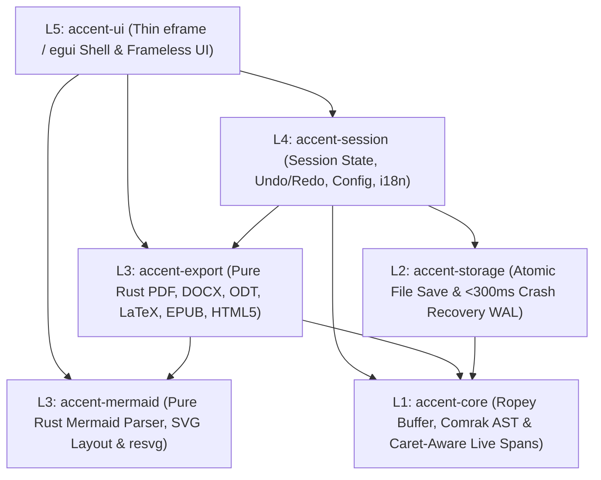

<div align="center">
  
  <h1>Accent Markdown Editor</h1>
  <p><strong>Editor e visualizzatore Markdown multipiattaforma in 100% puro Rust, veloce, elegante e privo di distrazioni.</strong></p>
  <p>
    
    
    
    
  </p>
</div>

---

## Panoramica

**Accent** (`v0.7.0`) è un editor e visualizzatore Markdown multipiattaforma progettato *clean-room* in **100% puro Rust** (`eframe` / `egui`, `comrak`, `ropey`, `resvg`). Offre un'esperienza di scrittura calda e priva di distrazioni, con finestra frameless ad angoli arrotondati, barre flottanti a scomparsa automatica durante la digitazione, anteprima contestuale in tempo reale (*View-while-typing*), rendering nativo GPU per diagrammi **Mermaid** ed esportazione diretta multipiattaforma senza alcuna dipendenza runtime esterna (zero Pandoc, zero LaTeX esterno, zero WebView/Chromium).


---

## Caratteristiche Principali

- **Caret-Aware Live Preview (*View-while-typing*):**
  Nasconde automaticamente i delimitatori sintattici Markdown (`**`, `*`, `~~`, `` ` ``, `#`, `[testo](url)`) renderizzando la tipografia formattata direttamente nel canvas di editing, e rivela istantaneamente i marcatori grezzi non appena il cursore o il mouse entra nello span interessato.
- **Finestra Frameless Multipiattaforma & Auto-Hide Immersivo:**
  Finestra con angoli arrotondati (`12px`), pulsanti *ghost* minimali e barre superiore/inferiore flottanti che sfumano a opacità `0%` durante la digitazione lasciando il 100% dell'altezza alla "carta" del documento.
- **Modalità Focus (*Hemingway*) & Zen (*F11*):**
  La modalità Focus attenua tutto il documento tranne il paragrafo attivo sotto il cursore; la modalità Zen espande l'editor a schermo intero senza distrazioni.
- **Rendering Nativo Mermaid su GPU (`accent-mermaid`):**
  Parser e motore di layout SVG in puro Rust per Flowchart (`graph`/`flowchart` `TD`/`LR` con nodi rettangolari, arrotondati, rombi decisionali e frecce etichettate) e Sequence Diagrams, rasterizzati ad alta densità di pixel (HiDPI) tramite `resvg` + `tiny-skia` con cache basata su hash del contenuto.
- **Pipeline di Esportazione 100% Rust (`accent-export`):**
  Esportazione autonoma compilata staticamente nel singolo binario:
  - **PDF** (paginazione tipografica A4 nativa con indice, tabelle, blocchi di codice e diagrammi vettoriali/raster)
  - **DOCX** (`docx-rs` Office Open XML nativo)
  - **ODT** (OpenDocument Text 1.2 nativo per LibreOffice Writer)
  - **LaTeX** (`.tex` compilabile con escaping rigoroso dei caratteri speciali)
  - **EPUB** (e-book reflowable standard)
  - **HTML5** (documento singolo auto-contenuto con foglio di stile tipografico)
- **Affidabilità Incondizionata (`accent-storage`):**
  - **Salvataggio Atomico (*Write-Temp → Fsync → Atomic Rename*):** zero corruzione dei file utente anche in caso di blackout o crash durante il salvataggio.
  - **Crash Recovery WAL (*Save-while-typing* `< 300ms`):** journal write-ahead automatico con banner di ripristino non distruttivo al riavvio.
- **Multi-Dialetto, Temi & Controllo Ortografico:**
  - Supporto **CommonMark**, **GitHub Flavored Markdown (GFM)** e **GitLab Flavored Markdown (GLFM)**.
  - Tre palette cromatiche calibrate: **Chiaro** (*Warm Paper*), **Seppia** e **Scuro**.
  - Controllo ortografico integrato e interfaccia localizzata in **Italiano**, **Inglese** e **Spagnolo**.

---

## Architettura a 5 Livelli (`L1`–`L5`)

Il workspace Cargo di Accent è organizzato in 5 livelli rigorosamente separati (i livelli inferiori non dipendono mai da quelli superiori):



| Crate | Livello | Responsabilità |
| :--- | :---: | :--- |
| `crates/accent-core` | **L1** | Buffer di testo `ropey::Rope`, parser AST `comrak`, mappa byte-offset e calcolo span *View-while-typing* (zero dipendenze GUI). |
| `crates/accent-storage` | **L2** | Salvataggio atomico POSIX/Windows (`write-temp -> fsync -> rename`) e Write-Ahead Recovery Journal (`< 300ms`). |
| `crates/accent-mermaid` | **L3** | Parser Mermaid in puro Rust, generatore SVG adattivo per tema e rasterizzatore `resvg` con cache content-hash. |
| `crates/accent-export` | **L3** | Esportatori nativi in puro Rust per PDF, DOCX, ODT, LaTeX, EPUB e HTML5. |
| `crates/accent-session` | **L4** | Stato della sessione, cronologia Undo/Redo, preferenze persistenti, dizionario ortografico e localizzazione (`it`, `en`, `es`). |
| `crates/accent-ui` | **L5** | Interfaccia utente `eframe`/`egui`, finestra frameless, Top/Bottom bar a scomparsa, anteprima split/separata e dialoghi nativi. |

---

## Installazione

### 1. Arch Linux (Pacchetto nativo `.pkg.tar.zst`)

Puoi costruire e installare il pacchetto nativo per Arch Linux direttamente tramite lo script incluso:

```bash
# Genera il pacchetto accent-markdown-editor-0.7.0-1-x86_64.pkg.tar.zst
./packaging/arch/build-arch-pkg.sh

# Installa il pacchetto con pacman
sudo pacman -U packaging/arch/accent-markdown-editor-0.7.0-1-x86_64.pkg.tar.zst
```

Oppure manualmente dalla cartella `packaging/arch`:

```bash
cd packaging/arch
makepkg -si
```

Una volta installato, puoi avviare **Accent** dal menu applicazioni del tuo Desktop Environment oppure da terminale:

```bash
accent documento.md
```

---

### 2. Windows 11 (Installazione User-Level — senza privilegi Amministratore)

Il pacchetto di installazione per **Windows 11** è progettato in modalità **User-Level** (`PrivilegesRequired=lowest`):
- Non richiede privilegi di Amministratore (nessun prompt UAC).
- Installa l'applicazione in `%LOCALAPPDATA%\Programs\Accent`.
- Crea i collegamenti nel Menu Start utente (`%APPDATA%\Microsoft\Windows\Start Menu\Programs\Accent`).
- Registra l'associazione per i file `.md` e `.markdown` e il disinstallatore in `HKEY_CURRENT_USER` (*Impostazioni di Windows 11 → App → App installate*).

#### Generazione del pacchetto su Windows 11:
```powershell
# Compila il binario di rilascio e genera sia l'installer Inno Setup (.exe) sia il pacchetto User Installer (.zip)
powershell -ExecutionPolicy Bypass -File .\packaging\windows\build-windows-pkg.ps1
```

#### Installazione diretta tramite script PowerShell User-Level (senza Inno Setup):
```powershell
powershell -ExecutionPolicy Bypass -File .\packaging\windows\install-user.ps1
```

Per disinstallare in qualsiasi momento:
```powershell
powershell -ExecutionPolicy Bypass -File .\packaging\windows\uninstall-user.ps1
```

---

## Compilazione da Sorgente (Sviluppo)

### Prerequisiti
- **Rust Toolchain** (`rustc >= 1.80`, `cargo`)
- Su Linux: librerie di sviluppo standard (`gtk3`, `libxkbcommon-x11`, `wayland`)

```bash
# Esegui l'intera suite di test del workspace
cargo test --workspace

# Avvia Accent in modalità release
cargo run --release -p accent-ui -- doc/esempio_accent.md
```

---

## Scorciatoie da Tastiera

| Scorciatoia | Azione |
| :--- | :--- |
| `Ctrl + N` | Nuovo documento |
| `Ctrl + O` | Apri documento |
| `Ctrl + S` | Salvataggio atomico immediato |
| `Ctrl + Shift + S` | Salva con nome... |
| `Ctrl + E` | Finestra di Esportazione (PDF, DOCX, ODT, LaTeX, EPUB, HTML5) |
| `Ctrl + Z` / `Ctrl + Shift + Z` | Annulla (Undo) / Ripeti (Redo) |
| `Ctrl + B` / `Ctrl + I` | Grassetto (`**`) / Corsivo (`*`) |
| `Ctrl + F` | Apri barra di Ricerca pillola |
| `Ctrl + H` | Apri barra di Ricerca e Sostituzione |
| `Ctrl + P` | Cicla modalità di editing / anteprima |
| `Ctrl + D` | Attiva / disattiva Modalità Focus (Hemingway) |
| `F8` | Attiva / disattiva Controllo Ortografico |
| `F10` | Apri Menu Principale (`☰`) |
| `F11` | Attiva / disattiva Modalità Zen (Schermo Intero) |
| `Esc` | Chiude popover, finestre modali, barra di ricerca o esce da Zen Mode |

---

## Gestione del Versioning

La versione corrente del progetto è definita in modo centralizzato nel file [`VERSION`](VERSION) (`0.7.0`) e in [`Cargo.toml`](Cargo.toml). Per aggiornare la versione in tutto il workspace e negli script di packaging Arch Linux e Windows 11:

```bash
./scripts/bump-version.sh 0.7.0
```

---

## Licenza

Distribuito sotto doppia licenza **MIT OR Apache-2.0**.
