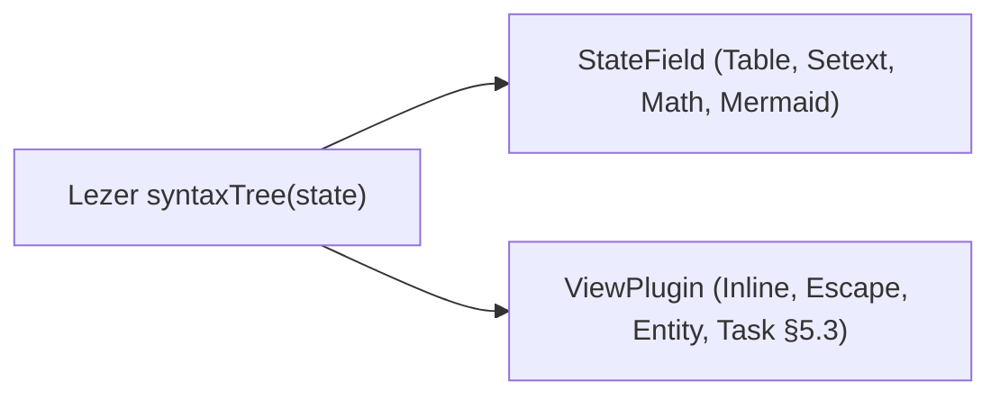

# Verifica Phase 5.3 — AST Live Preview & Task List Interattive

Paragrafo iniziale di parcheggio cursore (clicca qui per osservare il collasso AST completo oppure sposta il cursore dentro ciascun costrutto).

---

## 1. Task List Interattive (`§5.3`), Span Annidati (`§6.4`–`§6.5`), Escape (`§6.1`) & Entità (`§6.2`)

- [ ] Clicca questa checkbox `- [ ]` per commutarla in `- [x]` (poi verifica `Ctrl+Z`)
- [x] Attività già completata con ***grassetto corsivo*** e **bold con *italic* e `codice`**
1. [ ] Passo numerato aperto con ~barrato singola tilde~ e ~~barrato **bold**~~ (mentre ~~~tre tilde~~~ restano letterali)
> - [ ] Task annidato in citazione con escape \*non corsivo\*, \*\*non bold\*\* ed entità &copy; &euro; &#8594; &#x1F980;

Intestazione Setext su Due Righe (`§4.3`)
con Collasso Sottolineatura via StateField
------------------------------------------

    # §4.4 Blocco codice indentato (4 spazi: NON diventa heading!)
    - [x] Non diventa checkbox ma resta codice monospace
    > Non diventa citazione

> [!NOTE]
> Callout informativo GFM (`§5.1`) con *lazy continuation line* sulla riga seguente:
questa riga senza `>` appartiene comunque al callout quando il cursore è esterno.

> [!WARNING]
> Attenzione: code span multi-backtick ``usa `backtick` interno`` e link con parentesi [Voce Rust (wiki)](https://en.wikipedia.org/wiki/Rust_(programming_language)) + ref [Specifica GFM][gfm-spec] e <https://commonmark.org>.

[gfm-spec]: https://github.github.com/gfm/ "GitHub Flavored Markdown Spec 0.29-gfm"

## 2. Consolidamento `StateField`: Display Math (`$$...$$`) & Diagramma `Mermaid`

$$
\int_{0}^{+\infty} e^{-x^2}\,dx = \frac{\sqrt{\pi}}{2}
$$

  Blocco HTML §4.6: **questo testo dentro HTML non viene alterato da decorazioni Markdown o $math$**.

