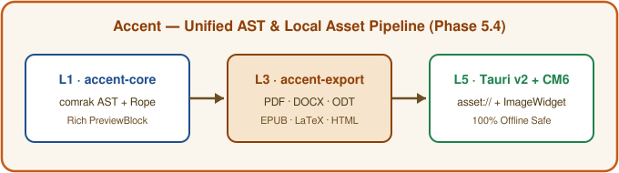

# Phase 5.4 — Immagini Locali (`§6.7`) & Esportatori AST

Questo documento verifica la risoluzione sicura dei path relativi rispetto a `current_file_path` (sia in **Anteprima in-line •** con `ImageWidget` caret-aware sia nello **Split Preview Pane** via protocollo `asset:` / `data:` sanitizzato) e la fedeltà degli esportatori Rust.

Icona locale PNG risolta con path relativo `./assets/accent_logo_5_4.png` e `../../img/brand/accent_logo.png`:  integrata nel paragrafo insieme a .

Fallback eleganti senza icone *broken image* grezze:  oppure .

---

## Tabella Ricca (`§4.10`) ed Elenchi Annidati (`§5.2`–`§5.4`)

| Modulo | Allineamento Centro | Esportazione Destra |
|:---|:---:|---:|
| **accent-core** (`L1`) | *AST unificato* & ~~split-brain~~ | `PreviewBlock` completo |
| **accent-export** (`L3`) | Immagini incorporate su **6 formati** | [Specifica GFM](https://github.github.com/gfm/ "GFM 0.29") |

> [!TIP]
> Citazione multi-blocco con **Alert GFM** e hard line break:\
> Seconda riga dopo `\` con codice `asset://localhost`.
>
> 3. [x] Risoluzione path relativi (`./`, `../`, `%20`)
>    - Incorporamento reale in PDF, DOCX, ODT, EPUB e HTML standalone
> 4. [ ] Verifica interattiva click-to-expand sul widget immagine
